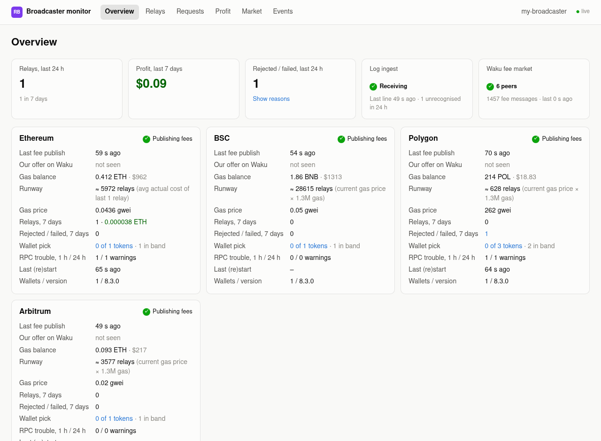
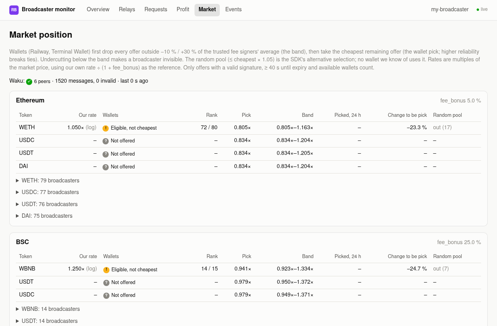

<p align="center"></p>

<h1 align="center">railgun-broadcaster-monitor</h1>

<p align="center">
A small, read-only, self-hosted dashboard for operators of a <a href="https://railgun.org">RAILGUN</a> broadcaster.<br>
One binary, SQLite, no keys, no cloud.
</p>

<p align="center">
<a href="https://github.com/Shogoki/railgun-broadcaster-monitor/actions/workflows/ci.yml"></a>
<a href="LICENSE"></a>
</p>

<p align="center">

</p>

> **Unofficial.** This project is not affiliated with or endorsed by RAILGUN or its contributors.

Running a broadcaster means answering the same questions again and again by grepping logs. `rbm` follows the broadcaster's log, asks public RPCs about the transactions it sent, listens to the public Waku fee market, and shows the answers in a browser:

| Question | What you get |
|---|---|
| **Is it healthy?** | Per chain: fee-publish freshness, restarts, RPC and sync trouble, gas balance and **runway** ("≈ N relays left"). |
| **Did it make money?** | Per relay: fee, estimated vs. **actual** gas cost (from the receipt), **profit and margin** in native and USD, route (`mev` / `mempool`), receipt status. Profit charts per day or week. |
| **What did it reject, and why?** | Rejected and failed requests **grouped by reason** (e.g. `Poi/ValidateList/InvalidSnarkProof`), per chain and day, each linked to its log lines. |
| **Would a wallet pick us?** | Our fee against every other broadcaster on Waku, modelled on how wallets really choose: rank, trusted-fee band, and the fee change needed to become the pick. See [docs/MARKET.md](docs/MARKET.md). |

<p align="center">
<br>
<sub>Screenshots show sample data (replayed log fixtures, a mock RPC for balances, and the live Waku fee market).</sub>
</p>

## Highlights

- **Small.** One ~15 MB binary with all assets embedded; about 25 MB RSS and ~0 % CPU when idle. SQLite in WAL mode. No Node, no external services.
- **Read-only, no keys.** It has no field for a mnemonic or private key and never reads the broadcaster's `config.yaml`. See [SECURITY.md](SECURITY.md).
- **Private by default.** Listens on `127.0.0.1` only, refuses a public bind without basic auth, sends a restrictive CSP and makes no third-party requests from the browser.
- **Survives restarts.** Every log line is deduplicated by hash, so restarting `rbm` or recreating the broadcaster container loses nothing that is still in the log source.
- **Tolerates log drift.** Lines the parser doesn't know are counted and shown, never fatal. The parser is versioned against the broadcaster commit it was written for.
- **Live.** Pages refresh through server-sent events.

## Quick start

You need a recent stable [Rust toolchain](https://rustup.rs) (edition 2024) or Docker, and the name of your broadcaster's container.

```sh
git clone https://github.com/Shogoki/railgun-broadcaster-monitor && cd railgun-broadcaster-monitor
cargo build --release                      # → target/release/rbm

cp config.example.toml rbm.toml
$EDITOR rbm.toml                           # your gas wallet, 0zk address, RPC URLs, fee_bonus
./target/release/rbm check-config

# Simplest log source: pipe the container's logs in.
docker logs -f --since 24h railgun-broadcaster 2>&1 | ./target/release/rbm ingest
```

Open <http://127.0.0.1:8080>. On a server, use an SSH tunnel: `ssh -L 8080:localhost:8080 your-host`.

The config holds **public data only**: your gas wallet address, your 0zk address, RPC URLs, token and RelayAdapt addresses. `rbm` refuses to start while the placeholder addresses from the example are still in place.

To look around without a live broadcaster, put any two valid-looking addresses in `rbm.toml`, then run `./target/release/rbm replay tests/fixtures/*.log && ./target/release/rbm run --source none`.

### Getting the logs

| Source | Setup | Trade-off |
|---|---|---|
| `journald` (recommended) | Broadcaster container uses the `journald` logging driver. `rbm` runs `journalctl -f` and resumes from its stored cursor. | Needs a one-time change to the broadcaster's compose file. Logs survive container recreation, and `rbm` only needs the `systemd-journal` group, not root. |
| `command` | `rbm` supervises `docker logs -f --since …` and restarts it when the container is recreated. | No change to the broadcaster, but needs Docker access, which is **root-equivalent**, and misses lines logged while the container is gone. |
| `stdin` | `docker logs -f … \| rbm ingest` | Simplest; you supervise the pipe. |

Details, the hardened systemd unit, and the Docker image are in [docs/DEPLOYMENT.md](docs/DEPLOYMENT.md).

### Commands

| Command | Purpose |
|---|---|
| `rbm run [--source …]` | Everything: log collector, receipt/balance/price enrichment, Waku listener, web UI. |
| `rbm ingest` | `run` with stdin as the log source. |
| `rbm replay FILE…` | Parse saved logs into the database (idempotent). Seeds older relays. |
| `rbm parse [FILE]` | Debug: print every line as parsed and classified JSON. No database. |
| `rbm check-config` | Validate the config and print a summary. |
| `rbm waku-probe [--secs 90] [--chain 137]` | Listen on Waku and print the fee market, e.g. to cross-check another viewer. |

The config path comes from `-c` or `RBM_CONFIG`, the log level from `RBM_LOG` (e.g. `RBM_LOG=debug`).

## Pages

| Page | Shows |
|---|---|
| **Overview** | KPI tiles and one card per chain: fee-publish freshness, gas balance, runway, gas price, 7-day relays and profit, rejections, wallet-pick status, RPC warnings, last restart. |
| **Relays** | One row per submitted transaction with fee, cost, profit, margin, route, receipt status and fee-note assurance. |
| **Requests** | Outcome counts, rejections grouped by reason and chain, a reason × day matrix, and every request with its correlated log lines. |
| **Profit** | Net profit and relay count per day or week, cumulative profit per chain, tables by chain and fee token. |
| **Market** | Our position against every other broadcaster on Waku, per chain and token. |
| **Events** | Parsed, redacted log lines and per-kind counts, including unrecognised lines, so you notice log-format drift. |

## Compatibility

- **Broadcaster:** developed against [`triamazikamno/railgun-broadcaster`](https://github.com/triamazikamno/railgun-broadcaster) (the Rust broadcaster) at commit `e5b36fc`, run with `RUST_LOG=info,broadcaster_service=debug` (the per-chain `our fees` lines are `DEBUG` and drive the fee-publish health check). The TypeScript broadcaster is not supported yet.
- **Chains:** Ethereum, BNB Chain, Polygon and Arbitrum are preconfigured in `config.example.toml`; any EVM chain RAILGUN supports can be added with a `[[chain]]` block.
- **Waku:** cluster 5, shard 1, via the light client of [`railgun-rust`](https://github.com/triamazikamno/railgun-rust). Build with `--no-default-features` to leave it out.

If a broadcaster update changes its log format, the **Events** page shows the unrecognised lines. Please open an issue with a few (redacted) examples.

## Documentation

- [docs/DEPLOYMENT.md](docs/DEPLOYMENT.md): journald, systemd, Docker, resource budget
- [docs/ARCHITECTURE.md](docs/ARCHITECTURE.md): parsing and correlation, numbers (profit, runway, route), storage, design decisions
- [docs/MARKET.md](docs/MARKET.md): how wallets choose a broadcaster and how the Market page models it
- [`config.example.toml`](config.example.toml): every setting, commented
- [SECURITY.md](SECURITY.md): threat model and how to report a vulnerability
- [CONTRIBUTING.md](CONTRIBUTING.md) · [CHANGELOG.md](CHANGELOG.md)

## Roadmap

- Alerts (ntfy, webhook, Telegram) with state-change semantics and "resolved" messages
- Dead-man switch (healthchecks.io style)
- Prometheus `/metrics`
- Several broadcasters in one UI
- Explorer backfill of relays from before the dashboard existed
- A log adapter for the TypeScript broadcaster

## License

[MIT](LICENSE). Bundled in the web UI: [htmx](https://htmx.org) (0BSD) and [uPlot](https://github.com/leeoniya/uPlot) (MIT); their licenses are in `assets/vendor/`. The Waku client comes from [`railgun-rust`](https://github.com/triamazikamno/railgun-rust) (MIT).
